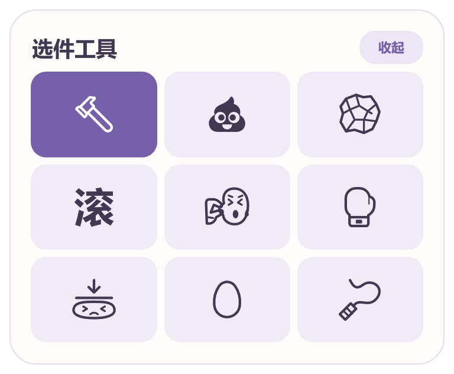

<h1 align="center">人工智障修理厂</h1>

<p align="center">
  <a href="#下载桌宠"></a>
  &nbsp;
  <a href="#连接-codex"></a>
</p>

<table align="center">
  <tr>
    <td align="center" width="33%"><a href="docs/images/hammer.png"></a><br><strong>橡皮锤</strong></td>
    <td align="center" width="33%"><a href="docs/images/whip.png"></a><br><strong>皮鞭</strong></td>
    <td align="center" width="33%"><a href="docs/images/stamp.png"></a><br><strong>滚</strong></td>
  </tr>
</table>

## 下载桌宠

选好版本，完整解压后打开桌宠。

<table>
  <thead>
    <tr><th align="left">系统</th><th align="left">下载</th><th align="left">解压后打开</th></tr>
  </thead>
  <tbody>
    <tr>
      <th align="left" rowspan="2">Windows</th>
      <td><a href="https://github.com/pandaxiong0729/ai-repair-shop/releases/download/v0.8.0/AI-Repair-Shop-Windows-x64.zip">Intel / AMD（x64）</a></td>
      <td><code>QiaoQiaoAI.Preview.exe</code></td>
    </tr>
    <tr>
      <td><a href="https://github.com/pandaxiong0729/ai-repair-shop/releases/download/v0.8.0/AI-Repair-Shop-Windows-arm64.zip">Windows 11 ARM64（如骁龙）</a></td>
      <td><code>AI-Repair-Shop.exe</code></td>
    </tr>
    <tr>
      <th align="left">macOS</th>
      <td><a href="https://github.com/pandaxiong0729/ai-repair-shop/releases/download/v0.8.0/AI-Repair-Shop-macOS-arm64.zip">Apple 芯片（M 系列）</a> · <a href="https://github.com/pandaxiong0729/ai-repair-shop/releases/download/v0.8.0/AI-Repair-Shop-macOS-x64.zip">Intel</a></td>
      <td><code>AI-Repair-Shop.app</code></td>
    </tr>
    <tr>
      <th align="left">Linux</th>
      <td><a href="https://github.com/pandaxiong0729/ai-repair-shop/releases/download/v0.8.0/AI-Repair-Shop-Linux-x64.tar.gz">Intel / AMD（x64）</a> · <a href="https://github.com/pandaxiong0729/ai-repair-shop/releases/download/v0.8.0/AI-Repair-Shop-Linux-arm64.tar.gz">ARM64</a></td>
      <td><code>AI-Repair-Shop/AI-Repair-Shop</code></td>
    </tr>
  </tbody>
</table>

首次打开会从 OpenAI 获取约 0.9 MB 的 Codex 角色图集，之后可以离线玩。[版本与校验文件](https://github.com/pandaxiong0729/ai-repair-shop/releases/latest)

## 连接 Codex

把这两行一起复制给电脑上的 Codex。

```text
请按这份说明帮我安装并启动人工智障修理厂。
https://github.com/pandaxiong0729/ai-repair-shop/blob/main/docs/INSTALL-CODEX.md
```

下次说「启动人工智障修理厂」就能叫出来，说「关闭人工智障修理厂」就会收起。

<details>
  <summary>敲打后，反馈会发到哪个聊天？</summary>
  <p>Skill 会选中第一下命中时你最近发过消息的 Codex 聊天。停手约两秒后，桌宠会自动提交一条纠错提示。按「重置」才开启下一轮。</p>
</details>

<details>
  <summary>Windows x64 工具箱</summary>
  <p></p>
</details>

<details>
  <summary>平台兼容与素材</summary>
  <p>Mac 安装包尚未经过 Apple 公证。Linux 版在 Ubuntu 22.04 x64 和 Ubuntu 24.04 ARM64 的 X11 环境中验证。<a href="docs/INSTALL-NATIVE.md">原生版安装说明</a></p>
  <p>公开版使用 Codex 角色，豆包和 DeepSeek 动画目前用于本地评审。<a href="docs/ASSETS.md">素材来源</a></p>
</details>

<hr>

<p align="center">
  <a href="README.zh-CN.md#从源码构建">从源码构建</a> &nbsp;·&nbsp;
  <a href="CONTRIBUTING.md">参与贡献</a> &nbsp;·&nbsp;
  <a href="LICENSE">Apache-2.0</a>
</p>
